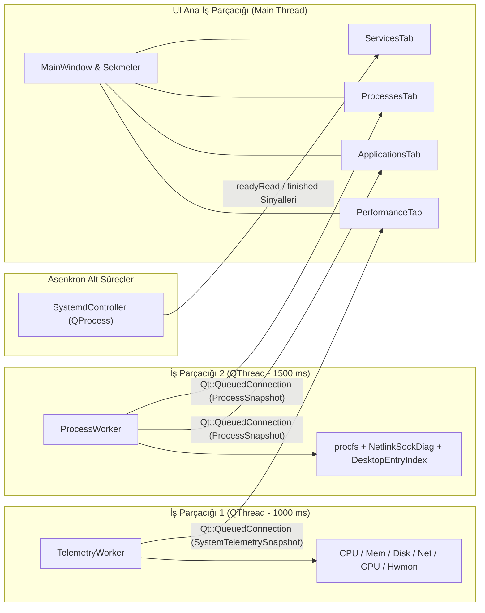

# Sistem İzleyicisi ve Komuta Merkezi — Mimari Plan (`PLAN.md`)

## 1. Proje Özeti ve Hedef Ortam

Bu belge, **Arch Linux (KDE Plasma Wayland)** masaüstü ortamı için geliştirilecek yerel, yüksek performanslı ve **Kvantum tema motoruyla %100 uyumlu** Sistem İzleyicisi ve Komuta Merkezi uygulamasının teknik mimarisini tanımlar.

| Bileşen | Hedef Teknoloji / Kural |
| :--- | :--- |
| **Programlama Dili** | Saf C++20 (`CMAKE_CXX_STANDARD 20`, eklentisiz `OFF`) |
| **Derleyici ve Araç Zinciri** | GCC (`g++` 16.2+), CMake 3.22+, Ninja |
| **Arayüz Çatısı** | Yalnızca yerel `Qt6::Widgets` (Qt 6.12 — Core, Gui, Widgets) |
| **Yasaklı Bağımlılıklar** | QCustomPlot, QtCharts, QtGraphs, KF6, QML veya harici UI/grafik kütüphaneleri yok |
| **Sistem Başlıkları ve API'ler** | Standart POSIX / Linux başlıkları (`dlfcn.h`, `signal.h`, `sys/resource.h`, `pwd.h`, `ifaddrs.h`, `sys/statvfs.h`, `linux/netlink.h`, `linux/sock_diag.h`, `linux/inet_diag.h`, `linux/tcp.h`) |
| **GPU (NVIDIA) Desteği** | Opsiyonel çalışma zamanı `dlopen("libnvidia-ml.so.1")` (derleme zamanı CUDA/NVML SDK bağımlılığı yok) |
| **Wayland & Uygulama Kimliği** | Yürütülebilir dosya adı `sysmonitor`; `QGuiApplication::setDesktopFileName("sysmonitortest1")`; sistem tema ikonu `utilities-system-monitor`; proje kökünde yerel `sysmonitortest1.desktop` şablonu; X11'e özgü API kullanılmaz |

---

## 2. Derleme Sistemi ve Proje Dizin Yapısı

### 2.1. `CMakeLists.txt` Kuralları
- `cmake_minimum_required(VERSION 3.22)`
- `project(SysMonitor VERSION 0.1.0 LANGUAGES CXX)`
- `set(CMAKE_CXX_STANDARD 20)` / `set(CMAKE_CXX_STANDARD_REQUIRED ON)` / `set(CMAKE_CXX_EXTENSIONS OFF)`
- `set(CMAKE_AUTOMOC ON)`
- `find_package(Qt6 REQUIRED COMPONENTS Widgets)`
- Yürütülebilir hedef: `add_executable(sysmonitor ...)`
- Bağlama: `target_link_libraries(sysmonitor PRIVATE Qt6::Widgets ${CMAKE_DL_LIBS})`
- Derleyici uyarıları: `target_compile_options(sysmonitor PRIVATE -Wall -Wextra -Wpedantic)`
- Standart derleme komutları:
  ```bash
  cmake -B build -G Ninja -DCMAKE_BUILD_TYPE=Release
  cmake --build build
  ```

### 2.2. Dizin ve Dosya Ağacı

```text
.
├── CMakeLists.txt
├── PLAN.md
├── sysmonitortest1.desktop
└── src
    ├── main.cpp
    ├── core
    │   ├── RingBuffer.h
    │   ├── TelemetryTypes.h
    │   ├── FormatUtils.h / FormatUtils.cpp
    │   ├── CpuCollector.h / CpuCollector.cpp
    │   ├── MemoryCollector.h / MemoryCollector.cpp
    │   ├── DiskCollector.h / DiskCollector.cpp
    │   ├── NetworkCollector.h / NetworkCollector.cpp
    │   ├── NvmlBridge.h / NvmlBridge.cpp
    │   ├── GpuCollector.h / GpuCollector.cpp
    │   ├── HwmonCollector.h / HwmonCollector.cpp
    │   ├── NetlinkSockDiag.h / NetlinkSockDiag.cpp
    │   ├── DesktopEntryIndex.h / DesktopEntryIndex.cpp
    │   ├── ProcessCollector.h / ProcessCollector.cpp
    │   ├── TelemetryWorker.h / TelemetryWorker.cpp
    │   ├── ProcessWorker.h / ProcessWorker.cpp
    │   └── SystemdController.h / SystemdController.cpp
    ├── widgets
    │   ├── AreaChartWidget.h / AreaChartWidget.cpp
    │   ├── DeviceListDelegate.h / DeviceListDelegate.cpp
    │   ├── CoreGridWidget.h / CoreGridWidget.cpp
    │   └── MemoryBarWidget.h / MemoryBarWidget.cpp
    ├── models
    │   ├── DeviceListModel.h / DeviceListModel.cpp
    │   ├── ApplicationTableModel.h / ApplicationTableModel.cpp
    │   ├── ProcessTableModel.h / ProcessTableModel.cpp
    │   ├── ProcessFilterProxyModel.h / ProcessFilterProxyModel.cpp
    │   └── ServiceTableModel.h / ServiceTableModel.cpp
    └── ui
        ├── MainWindow.h / MainWindow.cpp
        ├── PerformanceTab.h / PerformanceTab.cpp
        ├── ApplicationsTab.h / ApplicationsTab.cpp
        ├── ProcessesTab.h / ProcessesTab.cpp
        └── ServicesTab.h / ServicesTab.cpp
```

### 2.3. Çekirdek Modüller (`src/core/`)
- **`RingBuffer.h`**: Sabit kapasiteli (varsayılan 60–120 örnek) yığın tahsisi (heap allocation) yapmayan şablon dairesel tampon (`RingBuffer<T, Capacity>`). Grafik geçmişleri ve kayan pencere ortalamaları için kullanılır.
- **`TelemetryTypes.h`**: İş parçacıkları arasında kopyalanarak taşınan değişmez (immutable) veri yapıları (`CpuTelemetry`, `CoreTelemetry`, `MemoryTelemetry`, `DiskTelemetry`, `NetworkTelemetry`, `GpuTelemetry`, `FanTelemetry`, `ThermalSensor`, `SystemTelemetrySnapshot`, `ProcessInfo`, `ApplicationInfo`, `ProcessSnapshot`, `ServiceInfo`) ve `Q_DECLARE_METATYPE` bildirimleri.
- **`FormatUtils.h / .cpp`**: IEC ikili birim formatlayıcıları (`B/s`, `KiB/s`, `MiB/s`, `GiB`), frekans (`MHz` / `GHz`), çalışma süresi (`uptime`), yüzde ve sıcaklık (`°C`) biçimlendirme yardımcıları.
- **`CpuCollector.h / .cpp`**: `/proc/stat` (genel ve çekirdek başına delta kullanım + kullanıcı/sistem/iowait ayrımı), `/proc/cpuinfo` (model adı, satıcı), `/proc/uptime`, `/sys/devices/system/cpu/cpu*/cpufreq/*` (`scaling_cur_freq`, `cpuinfo_max_freq`, `base_frequency`, `scaling_driver`, `scaling_governor`) ve `/sys/devices/system/cpu/cpu*/cache/index*` (`shared_cpu_list` üzerinden tekilleştirilmiş L1d/L1i/L2/L3 önbellek boyutu — hibrit P/E çekirdekli işlemcilerle tam uyumlu).
- **`MemoryCollector.h / .cpp`**: `/proc/meminfo` (`MemTotal`, `MemAvailable`, `Buffers`, `Cached`, `SReclaimable`, `Shmem`, `SwapTotal`, `SwapFree`), `/proc/swaps` (ZRAM aygıtları dahil) ve varsa `hwmon` (`spd5118`) DIMM bellek sıcaklıkları.
- **`DiskCollector.h / .cpp`**: `/sys/block/*` altından yalnızca fiziksel NVMe/SATA/SCSI blok aygıtlarını keşfeder (`loop*`, `ram*`, `zram*` sanal aygıtları dışlanır). `/proc/diskstats` üzerinden delta okuma/yazma bayt/sn, IOPS, etkinlik % (`io_ticks`) ve ortalama yanıt süresi hesaplar; `device/model` (sondaki boşluklar temizlenerek), `queue/scheduler`, `/proc/mounts` + `statvfs()` ile bağlama noktası/kapasite bilgisi ve NVMe `hwmon` sıcaklıklarını okur.
- **`NetworkCollector.h / .cpp`**: `/sys/class/net/*` (`lo` hariç), `/proc/net/dev` üzerinden delta Rx/Tx hızları, oturum toplamları ve hata/kayıp paket sayaçları; `operstate`, `speed`, `address` (MAC), `mtu`, `/sys/class/net/<iface>/wireless` varlığı ile Wi-Fi/Ethernet ayrımı ve `getifaddrs()` ile IPv4/IPv6 adreslerini toplar.
- **`NvmlBridge.h / .cpp`**: `dlopen("libnvidia-ml.so.1", RTLD_LAZY | RTLD_LOCAL)` ile çalışma zamanında yüklenen güvenli NVML köprüsü (`nvmlInit_v2`, `nvmlShutdown`, `nvmlDeviceGetCount_v2`, `nvmlDeviceGetHandleByIndex_v2`, `nvmlDeviceGetName`, `nvmlDeviceGetPciInfo_v3`, `nvmlDeviceGetUtilizationRates`, `nvmlDeviceGetMemoryInfo`, `nvmlDeviceGetTemperature`, `nvmlDeviceGetClockInfo`, `nvmlDeviceGetPowerUsage`, `nvmlDeviceGetFanSpeed`, `nvmlDeviceGetComputeRunningProcesses`, `nvmlDeviceGetGraphicsRunningProcesses`, `nvmlDeviceGetProcessUtilization`). Hibrit Optimus dizüstü bilgisayarlarda `/sys/class/drm/card*/device/power_state == "D3cold"` kontrolü yaparak uyuyan harici GPU'yu her saniye gereksiz yere uyandırmaz (pil dostu; kullanıcı isteğine bağlı "Uyuyan GPU'yu Yokla" seçeneğiyle esnetilebilir).
- **`GpuCollector.h / .cpp`**: `/sys/class/drm/card[0-9]*` dizinini dinamik tarar (`card0` varsayımı yapılmaz; örn. `card1` + `card2` sistemlerle uyumlu). PCI satıcı/aygıt kimliklerini `/usr/share/hwdata/pci.ids` üzerinden tembel (lazy) çözer ve sürücüye göre strateji uygular:
  - **NVIDIA (`nvidia`)**: `NvmlBridge` üzerinden kullanım %, VRAM, çekirdek/bellek saat hızı, sıcaklık, güç (W), fan % ve GPU süreçleri.
  - **AMD (`amdgpu`)**: `device/gpu_busy_percent`, `device/mem_info_vram_used`, `device/mem_info_vram_total`, kart içi `hwmon` sıcaklık/güç/fan.
  - **Intel (`i915` / `xe`)**: `gt/gt0/rc6_residency_ms` üzerinden delta RC6 boşta kalma süresiyle kök yetkisiz gerçek kullanım yüzdesi ($\text{clamp}(100 \times (1 - \Delta\text{RC6} / \Delta\text{Wall}), 0, 100)$), `gt_act_freq_mhz` / `gt_cur_freq_mhz` / `gt_RP0_freq_mhz` saat hızları ve DRM `fdinfo`.
- **`HwmonCollector.h / .cpp`**: `/sys/class/hwmon/hwmon*` taraması yapar; ardışık olmayan sensör indekslerini (`temp1`, `temp2`, `temp6`, `temp10`...) güvenle okuyarak `fan*_input` (RPM), `pwm*` / `pwm*_enable` ve tüm `temp*_input` + `temp*_label` sensörlerini (CPU `coretemp`/`k10temp`, NVMe, ACPI `acpitz`, RAM `spd5118`, Wi-Fi `iwlwifi`) toplar; fan cihazlarıyla ilişkili sıcaklık sensörlerini eşleştirir.
- **`NetlinkSockDiag.h / .cpp`**: Kök yetkisi gerektirmeden Linux `NETLINK_SOCK_DIAG` (`AF_INET`/`AF_INET6`, `IPPROTO_TCP`, `INET_DIAG_INFO` -> `struct tcp_info.tcpi_bytes_sent` / `tcpi_bytes_received` + `inet_diag_msg.idiag_inode`) sorgular; soket inode -> delta Rx/Tx bayt/sn haritası üretir.
- **`DesktopEntryIndex.h / .cpp`**: `/usr/share/applications`, `/usr/local/share/applications`, `~/.local/share/applications` ve Flatpak export dizinlerindeki `.desktop` dosyalarını önbelleğe alır (`Name[tr]`/`Name`, `Icon`, `Exec`, `StartupWMClass`, `NoDisplay`, `Hidden`, `Type=Application`). Simgeler aktif KDE temasından `QIcon::fromTheme()` ile çözülür.
- **`ProcessCollector.h / .cpp`**: `/proc/[pid]` taraması (`stat`, `statm`, `comm`, `cmdline`, `status`, `io`, `cgroup`, `fd`), `getpwuid_r` ile UID->kullanıcı adı önbelleği, `NetlinkSockDiag` ile süreç bazlı TCP ağ hızı ve `NvmlBridge` + DRM `fdinfo` ile süreç bazlı GPU % / VRAM verisi toplar; hem ham süreç listesini (Sekme 3) hem de gruplanmış uygulama listesini (Sekme 2) üretir. Performans kuralı olarak `/proc/[pid]/fdinfo/*` dosyaları asla tüm süreçler/tanıtıcılar için körlemesine açılmaz: `/proc/[pid]/fd/*` üzerinde tek geçişli `readlink` taramasında soket inodları (`socket:[inode]`) toplanırken yalnızca hedefi `/dev/dri/` ile başlayan (ör. `/dev/dri/renderD*`, `/dev/dri/card*`) dosya tanıtıcılarının ilgili `/proc/[pid]/fdinfo/<fd>` kayıtları (`drm-engine-*`, `drm-memory-*` / `drm-resident-*`) okunur.
- **`TelemetryWorker.h / .cpp`**: `QThread` #1 üzerinde `QTimer` (varsayılan 1000 ms) ile çalışan donanım telemetri işçisi.
- **`ProcessWorker.h / .cpp`**: `QThread` #2 üzerinde `QTimer` (varsayılan 1500 ms) ile çalışan süreç ve uygulama toplayıcı işçisi.
- **`SystemdController.h / .cpp`**: Asenkron `QProcess` ile `systemctl` birim listeleme (`--system` ve `--user`), `pkexec systemctl` / `systemctl --user` kontrol eylemleri ve `journalctl` günlük okuyucu + canlı `-f` takip akışı.

---

## 3. Kvantum ve Aktif `QStyle` Uyumluluk Sözleşmesi (Sıfır-QSS Mimari Kuralı)

Bu projenin görsel bütünlüğü, sistemdeki aktif KDE Plasma / Kvantum temasının renklerine, saydamlık/bulanıklık efektlerine ve kontrol geometrisine %100 saygı duymaya dayanır.

### 3.1. Kesin Yasaklar
- Kod tabanının **hiçbir yerinde** `setStyleSheet(...)` çağrısı yapılmayacaktır.
- Kod tabanının **hiçbir yerinde** sabit hex renk kodu (`#xxxxxx`) veya sabit RGB renk kodu (`QColor(r, g, b)`) tanımlanmayacaktır.

### 3.2. Doğal Tema ve Palet Kullanımı
- Tüm standart kontroller (`QMainWindow`, `QTabWidget`, `QSplitter`, `QListView`, `QTableView`, `QHeaderView`, `QFrame`, `QPushButton`, `QLineEdit`, `QPlainTextEdit`, `QMenu`, `QStatusBar`) doğrudan aktif `QStyle` (Kvantum) tarafından çizilir.
- `QPlainTextEdit` (`journalctl` günlük paneli) QSS kullanmadan sabit genişlikli sistem yazı tipini `QFontDatabase::systemFont(QFontDatabase::FixedFont)` ile alır.
- Özel sol cihaz listesi delegesi (`DeviceListDelegate`), satır arka planı, fare üzeri (hover) ve seçili durum vurgularını Kvantum'un yarı-saydam ve yuvarlatılmış köşe efektlerini bozmamak için doğrudan `style->drawPrimitive(QStyle::PE_PanelItemViewItem, &opt, painter, widget)` üzerinden çizer.

### 3.3. Şeffaf Özel Alan Grafiği (`AreaChartWidget`)
- `QWidget` alt sınıfıdır. Kurucusunda **yalnızca** `setAutoFillBackground(false)` ayarlanır; Wayland'de alt bileşenlerde siyah arka plan hatasına yol açtığı için `AreaChartWidget` ve diğer alt bileşenlerde kesinlikle `setAttribute(Qt::WA_TranslucentBackground, true)` **kullanılmaz**. `paintEvent` içinde arka plan boyanmadan bırakılarak alttaki Kvantum pencere/panel yüzeyinin doğal olarak görünmesi sağlanır.
- `QPainter` üzerinde `QPainter::Antialiasing` her zaman açıktır.
- **Dinamik Renk Türetimi (Tamamı `QApplication::palette()` Üzerinden):**
  - **Ana seri çizgisi:** `QApplication::palette().color(QPalette::Highlight)` (2 px antialias eğri).
  - **Alan dolgu gradyanı (`QLinearGradient`, üstten alta):** Üst durakta `highlight` (`alphaF = 0.35`), alt durakta `highlight` (`alphaF = 0.02`).
  - **İkincil seri (Disk Yazma / Ağ Yükleme / İkincil Sıcaklık):** `QApplication::palette().color(QPalette::Link)`; eğer `Highlight` ile renk tonu açısı çok yakınsa `QColor::fromHslF` ile dinamik ton kaydırması ve `Qt::DashLine` çizim uygulanır (sabit RGB kullanılmaz).
  - **Yardımcı ızgara çizgileri:** `QApplication::palette().color(QPalette::Mid)` (`alphaF = 0.25`).
  - **Eksen ve değer etiketleri:** `QApplication::palette().color(QPalette::Text)` ve `QPalette::PlaceholderText`.
- **Canlı Tema Tepkisi:** `changeEvent(QEvent*)` içinde `QEvent::PaletteChange`, `QEvent::ApplicationPaletteChange` ve `QEvent::StyleChange` olayları yakalanarak anında `update()` çağrılır; kullanıcı Plasma temasını değiştirdiği anda grafikler yeniden boyanır.
- **Çift Çalışma Modu:**
  1. `Sparkline`: Sol cihaz listesi ve CPU mantıksal çekirdek ızgarası için yalın çizgi + alan gradyanı.
  2. `Detailed`: Orta ana panel için ızgara çizgileri, dinamik veya sabit Y ekseni ölçeği, isteğe bağlı çift seri ve fare üzerine gelince anlık değer okuma ipucu.

---

## 4. Dört Ana Sekmenin Detaylı Mimarisi

### 4.1. Sekme 1 — Performans (`PerformanceTab`)
Yatay 3 bölmeli `QSplitter` düzeni kullanır:

- **Sol Panel (`QListView` + `DeviceListModel` + `DeviceListDelegate`):**
  Dinamik olarak keşfedilen tüm donanım birimlerini canlı mini `Sparkline` alan grafikleri ve özet metriklerle listeler:
  1. **CPU** (genel kullanım % + anlık frekans)
  2. **Bellek** (kullanılan / toplam GiB + %)
  3. **NVMe / Fiziksel Diskler** (okuma/yazma toplam hızı + etkinlik %)
  4. **Ağ Arayüzleri** (`eno1`, `wlo1` vb. fiziksel arayüzler — indirme/yükleme hızı)
  5. **GPU'lar** (algılanan her iGPU ve dGPU için ayrı satır — kullanım % ve VRAM/frekans)
  6. **Fanlar ve Termal (`/sys/class/hwmon`)** (fan RPM değerleri + eşleştirilmiş sıcaklıklar; ek olarak sistem termal özeti)

- **Orta Panel (Detaylı Canlı Grafik ve Özel Görünümler):**
  Seçili cihaza göre `AreaChartWidget` (`Detailed` modu) ve bağlama özel alt bileşenleri gösterir:
  - **CPU seçiliyken:** Üst araç çubuğunda görünüm anahtarı (**Genel Kullanım** ↔ **Mantıksal Çekirdekler (Izgara)**). Izgara modunda `CoreGridWidget` (`QScrollArea` içinde duyarlı `QGridLayout`), her mantıksal çekirdek için bağımsız canlı mini `AreaChartWidget`, anlık % ve MHz frekansını gösterir.
  - **Bellek seçiliyken:** Bellek kullanım grafiği + altında `MemoryBarWidget` (Aktif / Önbellek-Tampon / Boş / Swap-ZRAM dağılım çubuğu).
  - **Disk ve Ağ seçiliyken:** Çift serili otomatik ölçeklenen alan grafiği (Disk: Okuma + Yazma; Ağ: İndirme + Yükleme).
  - **GPU seçiliyken:** Kullanım % ana grafiği + ikincil seri olarak VRAM kullanımı (NVIDIA/AMD) veya saat hızı MHz (Intel iGPU).
  - **Fan/Termal seçiliyken:** RPM alan grafiği + eşzamanlı sıcaklık grafiği ve tüm `hwmon` sensörlerinin canlı tablosu.

- **Sağ Panel (Teknik Künye — `QScrollArea` + `QFormLayout`):**
  Seçili donanıma özgü teknik bilgileri dinamik olarak listeler:
  - **CPU:** Model, fiziksel/mantıksal çekirdek sayısı, anlık/taban/maks frekans, çalışma süresi (`uptime`), L1d/L1i/L2/L3 önbellek boyutları, ölçekleme sürücüsü (`intel_pstate`/`amd-pstate`), governor, süreç/iş parçacığı sayısı, paket sıcaklığı.
  - **Bellek:** Toplam, Kullanılan, Kullanılabilir, Önbellek/Tampon, Paylaşılan (`Shmem`), Swap/ZRAM kullanımı, varsa `spd5118` DIMM sıcaklıkları.
  - **Disk:** Aygıt yolu (`/dev/nvme0n1` vb.), model, toplam kapasite, okuma/yazma hızı ve toplam G/Ç, etkinlik %, I/O scheduler, NVMe sıcaklığı, bağlama noktaları.
  - **Ağ:** Arayüz adı, tür (Ethernet/Wi-Fi), bağlantı durumu ve hızı (`operstate`/`speed`), IPv4/IPv6 adresleri, MAC adresi, MTU, indirme/yükleme hızı, oturum toplamları, paket hata/kayıpları.
  - **GPU:** Model adı, çekirdek sürücüsü, PCI yolu ve güç durumu (`D0`/`D3cold`), kullanım %, VRAM (kullanılan/toplam), çekirdek/bellek saat hızı, sıcaklık, güç tüketimi (W), fan %, aktif GPU süreç sayısı.
  - **Fan/Termal:** `hwmon` kaynak adı, anlık/min/maks RPM, PWM % ve kontrol modu, ilişkili sistem sıcaklıkları.

### 4.2. Sekme 2 — Uygulamalar (`ApplicationsTab`)
Yalnızca kullanıcının masaüstü uygulamalarını gösterir; her uygulamanın tüm alt ve yardımcı süreçlerini (örn. tarayıcı sekmeleri, Electron renderer/GPU yardımcıları) tek satırda toplar.

- **İki Katmanlı Gruplama Algoritması (KDE Plasma Wayland Uyumlu):**
  1. **Birincil (Systemd cgroup v2 `app.slice`):** `/proc/[pid]/cgroup` yolu içindeki kullanıcı oturumu kapsamları (`app-<desktop-id>-<pid>.scope`, `app-<desktop-id>@<instance>.service`, `app-flatpak-<app-id>-<pid>.scope`) ayrıştırılır, systemd kaçış dizileri (`\x2d` vb.) çözülür ve `DesktopEntryIndex` üzerinden `.desktop` kimliğiyle eşleştirilir.
  2. **Yedek (`.desktop` + PPID Soy Ağacı):** `app.slice` dışında başlatılmış kullanıcı masaüstü uygulamaları için `/proc/[pid]/exe`, `cmdline` ve `comm` değerleri `.desktop` `Exec` ve `StartupWMClass` alanlarıyla eşleştirilir; PPID soy ağacındaki alt süreçler aynı uygulama satırında toplanır. Çekirdek iş parçacıkları (`kthreadd` soyu) ve saf arka plan sistem servisleri kapsam dışı bırakılır.
- **Sütunlar:** Uygulama Adı (KDE tema simgesi + toplanan alt süreç sayısı), CPU %, Bellek (RAM / RSS), Paylaşılan Bellek, Disk G/Ç (Okuma + Yazma B/s), Ağ (Rx + Tx B/s), GPU %, VRAM.
- **Etkileşimler:** Anlık arama kutusu, ham sayısal değere göre sıralama, sağ tık bağlam menüsü (`Uygulamayı Kapat (SIGTERM)`, `Zorla Sonlandır (SIGKILL)`, `Alt Süreçleri "Süreçler" Sekmesinde Göster`).

### 4.3. Sekme 3 — Süreçler (`ProcessesTab` — Bağımsız Tam Liste)
Uygulamalar sekmesinden tamamen bağımsız olarak `/proc` altındaki her bir işlemi gruplamadan doğrudan gerçek süreç/ikili adıyla listeleyen sanal tablo yapısıdır.

- **Model/Görünüm Mimarisi:** Sanal `QTableView` + `ProcessTableModel` (`QAbstractTableModel`) + `ProcessFilterProxyModel` (`QSortFilterProxyModel`).
- **Artımlı Güncelleme (Seçim Koruma):** Her yenilemede `beginResetModel()` **çağrılmaz**. PID haritası üzerinden yalnızca yeni eklenen/sonlanan satırlar için `beginInsertRows`/`beginRemoveRows`, değişen hücreler için `dataChanged` yayımlanır. Bu sayede tablo kaydırma konumu, seçili satır ve açık sağ tık menüsü asla sıfırlanmaz.
- **11 Sütun:**
  1. Süreç Adı (`/proc/[pid]/comm`, fare ipucunda tam `cmdline`)
  2. PID
  3. Kullanıcı
  4. Durum (`Çalışıyor`, `Uyuyor`, `Disk Uykusu`, `Durduruldu`, `Zombi`)
  5. CPU %
  6. Bellek (RSS)
  7. Paylaşılan Bellek
  8. Disk Okuma/Yazma
  9. Ağ (Rx/Tx)
  10. GPU %
  11. GPU Belleği (VRAM)
- **Üst Araç Çubuğu:** Anlık arama/filtre kutusu (Ad, PID, Kullanıcı ve `cmdline` üzerinde filtreleme), hızlı filtre seçici (`Tümü`, `Kullanıcı Süreçlerim`, `Yüksek CPU`, `GPU Kullananlar`), canlı toplam süreç / iş parçacığı sayacı.
- **Sağ Tık Bağlam Menüsü:**
  - `Sonlandır (SIGTERM)` → `kill(pid, SIGTERM)`
  - `Zorla Öldür (SIGKILL)` → onay penceresi ile `kill(pid, SIGKILL)`
  - `Duraklat (SIGSTOP)` → `kill(pid, SIGSTOP)`
  - `Devam Ettir (SIGCONT)` → `kill(pid, SIGCONT)`
  - `Öncelik Değiştir (nice)` → hazır değerler (`-10`, `-5`, `0`, `+5`, `+15`) veya özel sayı (`-20..19`) ile `setpriority(PRIO_PROCESS, pid, nice)`
  - **Yetki Yönetimi:** `EPERM` hatasında kullanıcıya açık bilgilendirme ve isteğe bağlı `pkexec` ile yükseltilmiş yürütme (`pkexec kill` / `pkexec renice`).
- **Süreç Bazlı Disk ve Ağ Yetki Gerçekçiliği:**
  - Kullanıcının kendi süreçleri için `/proc/[pid]/io` ve `/proc/[pid]/fd` doğrudan okunur; başka kullanıcılara ait okunamayan (`EACCES`) süreçlerde sahte `0` yerine dürüst `—` (açıklayıcı araç ipucuyla) gösterilir.
  - Ağ sütunu `/proc/[pid]/net/dev` (tüm ağ ad alanı toplamını döndüren tuzak) kullanmaz; `NETLINK_SOCK_DIAG` (`tcp_info`) ve `/proc/[pid]/fd` soket inode eşleştirmesiyle gerçek süreç bazlı TCP Rx/Tx hızını kök yetkisiz hesaplar (UDP/QUIC ve okunamayan PID sınırları araç ipucunda şeffaf biçimde belirtilir).

### 4.4. Sekme 4 — Servisler (`ServicesTab`)
- **Üst Kontrol Çubuğu:** Kapsam seçici (`Sistem Servisleri` / `Kullanıcı Servisleri (--user)`), durum filtresi (`Tümü`, `Aktif`, `Pasif`, `Hatalı`), anlık arama kutusu, `Başlat`, `Durdur`, `Yeniden Başlat`, `Yenile` butonları.
- **Dikey `QSplitter` Yerleşimi:**
  - **Üst Bölme:** `QTableView` + `ServiceTableModel` + filtre vekili (`Birim Adı`, `Yükleme`, `Aktiflik`, `Alt Durum`, `Açıklama`). Veriler `systemctl list-units --type=service --all --no-pager --no-legend --plain` komutuyla asenkron `QProcess` üzerinden alınır.
  - **Alt Bölme:** Seçili birimin son `journalctl` günlüklerini (`journalctl -u <birim> -n 150 --no-pager --output=short-iso` veya `--user-unit`) gösteren salt okunur `QPlainTextEdit` ve `Canlı Takip (-f)` anahtarı.
- **Servis Kontrolü:** Sistem birimleri için `Başlat` / `Durdur` / `Yeniden Başlat` komutları asenkron `pkexec systemctl <eylem> <birim>` çağrısıyla KDE Polkit kimlik doğrulama penceresini arayüzü dondurmadan tetikler; kullanıcı birimleri doğrudan `systemctl --user` ile yönetilir.

---

## 5. Çoklu İş Parçacığı (Threading) ve Performans Mimarisi



### Temel Tasarım İlkeleri
1. **Sıfır UI Blokajı:** UI ana iş parçacığı hiçbir zaman `/proc`, `/sys`, `dlopen`/NVML, Netlink soketi veya `systemctl`/`journalctl` G/Ç çağrısı yapmaz.
2. **Kilitsiz Anlık Görüntü Aktarımı:** İş parçacıkları arası veri paylaşımı yalnızca değişmez (immutable) snapshot yapıları ve `Qt::QueuedConnection` sinyalleriyle yapılır; UI iş parçacığında mutex beklemesi yaşanmaz.
3. **Temiz Kapanış Protokolü:** Uygulama kapanırken sırasıyla arka plan `QTimer::stop()` çağrıları `QueuedConnection` ile iletilir, aktif `journalctl -f` süreçleri `terminate()`/`kill()` ile kapatılır, iş parçacıkları `QThread::quit()` + `QThread::wait()` ile beklenir ve `NvmlBridge` (`nvmlShutdown()` + `dlclose()`) güvenli biçimde serbest bırakılır.

---

## 6. Bilinen Linux / Arch / KDE Plasma Tuzakları ve Önlemler

| # | Bilinen Tuzak / Risk | Alınacak Mimari Önlem |
| :--- | :--- | :--- |
| **1** | DRM GPU kartlarının `card0` yerine `card1` / `card2` olarak numaralanması | Sabit `card0` varsayımı yapılmaz; `/sys/class/drm/card[0-9]*` dinamik taranır. |
| **2** | Hibrit Optimus laptoplarda `D3cold` uyuyan NVIDIA GPU'yu yoklamanın pili tüketmesi | NVML sorgusu öncesi `device/power_state` okunur; `D3cold` durumunda GPU uyandırılmaz (isteğe bağlı ayar hariç). |
| **3** | Hibrit Intel P/E çekirdeklerde L1/L2/L3 önbellek toplamının çekirdek sayısıyla yanlış çarpılması | `/sys/devices/system/cpu/cpu*/cache/index*/shared_cpu_list` üzerinden önbellek örnekleri tekilleştirilir. |
| **4** | `hwmon` sensör indekslerinin boşluklu olması ve fanların sıcaklık içermeyen ayrı düğümde yer alması | Sabit `1..N` döngüsü yerine dosya adı kalıbıyla tarama yapılır ve tüm `hwmon` sıcaklıkları çapraz eşleştirilir. |
| **5** | `/proc/[pid]/net/dev` dosyasının süreç yerine tüm ağ ad alanını döndürmesi | Bu yanılgı kullanılmaz; `NETLINK_SOCK_DIAG` (`tcp_info`) + `fd` inode eşleştirmesi kullanılır; okunamayan PID'lerde `—` gösterilir. |
| **6** | Tablo yenilemesinde `beginResetModel()` çağrısının seçimi, sıralamayı ve kaydırmayı bozması | PID haritası üzerinden artımlı `beginInsertRows`/`beginRemoveRows`/`dataChanged` fark güncellemesi uygulanır. |
| **7** | Biçimlendirilmiş metin sütunlarının (`"1.2 GiB"`, `"950 KiB/s"`) alfabetik yanlış sıralanması | Proxy model `Qt::UserRole` üzerinden ham sayısal (`uint64_t` / `double`) değerlerle sıralama yapar. |
| **8** | Farkında olmadan Kvantum saydamlığını bozan QSS veya sabit renk sızıntısı | Derleme sonrası tüm `src/` altında `setStyleSheet` ve sabit hex/RGB taraması ile sıfır ihlal doğrulanır. |
| **9** | Wayland'de alt widget'larda `Qt::WA_TranslucentBackground` kullanımıyla oluşan siyah arka plan hatası | Alt bileşenlerde kesinlikle `WA_TranslucentBackground` ayarlanmaz; yalnızca `setAutoFillBackground(false)` kullanılır ve `paintEvent` arka planı boyamadan bırakır. |
| **10** | Tüm süreçlerin `/proc/[pid]/fdinfo/*` dosyalarını körlemesine açmanın oluşturduğu yüksek G/Ç maliyeti | `/proc/[pid]/fd/*` üzerinde `readlink` ile yalnızca hedefi `/dev/dri/` ile başlayan tanıtıcıların `fdinfo` kayıtları okunur. |

---

## 7. Aşamalı Uygulama ve Doğrulama Planı

1. **Faz 1 — İskelet ve Kvantum Tema Altyapısı:**
   `CMakeLists.txt`, `sysmonitortest1.desktop` şablonu, `src/main.cpp`, `MainWindow` (4 sekme kabuğu) ve `AreaChartWidget` şeffaf alan grafiğinin oluşturulması; Kvantum altında saydamlık ve canlı palet tepkisinin doğrulanması.
2. **Faz 2 — Donanım Telemetrisi ve Sekme 1 (Performans):**
   `TelemetryWorker` + 6 donanım toplayıcısı (`Cpu`, `Memory`, `Disk`, `Network`, `Gpu`/`NvmlBridge`, `Hwmon`), `RingBuffer`, `DeviceListModel`/`Delegate`, `CoreGridWidget`, `MemoryBarWidget` ve sağ teknik künye panelinin tamamlanması.
3. **Faz 3 — Süreçler (Sekme 3) ve Uygulamalar (Sekme 2):**
   `ProcessWorker`, `NetlinkSockDiag`, `DesktopEntryIndex`, artımlı `ProcessTableModel`, `ProcessesTab` (11 sütun + arama + bağlam menüsü) ve cgroup/desktop gruplu `ApplicationsTab` uygulamasının tamamlanması.
4. **Faz 4 — Servisler ve Günlükler (Sekme 4):**
   `SystemdController`, `ServiceTableModel`, `ServicesTab` (sistem/kullanıcı kapsamı, `pkexec` kontrolleri, `journalctl` günlük paneli ve `-f` canlı takip).
5. **Faz 5 — Bütünleşik Doğrulama:**
   Sıfır derleyici uyarısı (`-Wall -Wextra -Wpedantic`) ile temiz C++20 derlemesi, `grep` ile sıfır `setStyleSheet` / sabit renk denetimi, Kvantum tema değişim testi, çoklu iş parçacığı kararlılık ve temiz kapanış testi.
