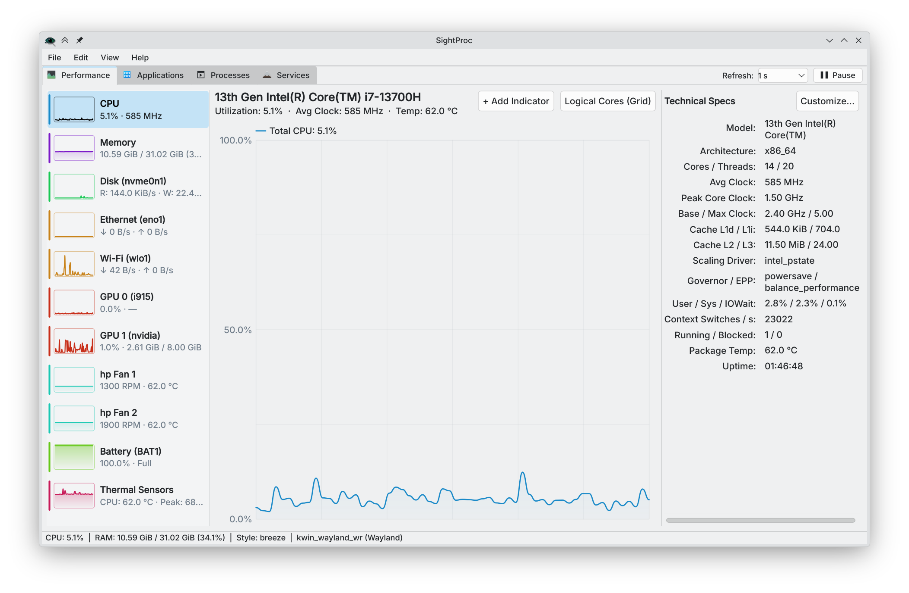
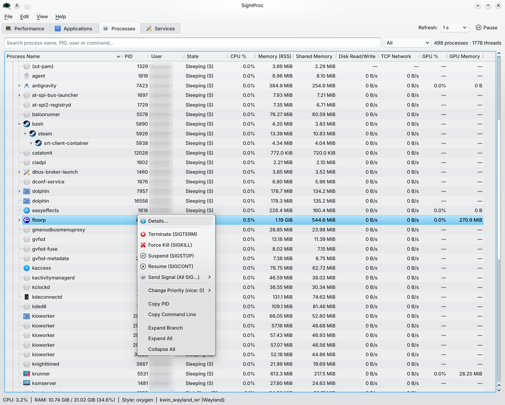
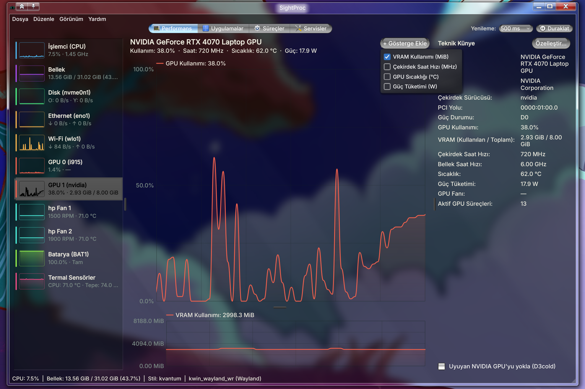
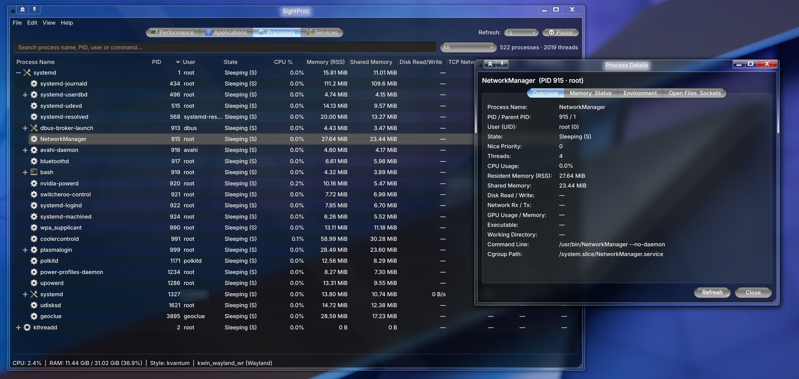
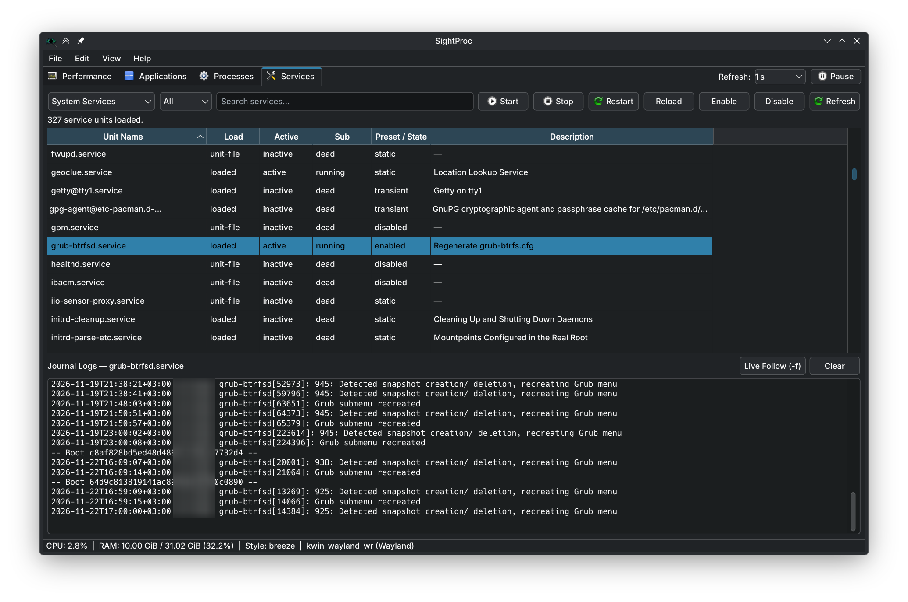

# SightProc

A native GNU/Linux system monitor and process manager built with C++20 and Qt6 Widgets.

## Screenshots

*Performance tab with Breeze Light*


*Processes tab with Oxygen Light* 


<details>
<summary>More screenshots (My blurry setup, Services, Processes...)</summary>


*Performance tab with my Kvantum blur setup*


*Detailed processes tab*


*Services tab with Breeze Dark*

</details>

## Design Philosophy 

**SightProc gives you full control over your theming.** No QSS, no QML, no restrictive theming and just pure QStyle. You should decide how apps should look on your device, not the developer. (also low ram usage thanks to that)
- **Native `QStyle` & `QPalette`:** All controls follow the desktop's active style engine (such as **Kvantum**, **Breeze**, or **Oxygen**) and system color palette without overrides.
- **Custom `QPainter` Charts:** Live performance charts are implemented directly as `QWidget` subclasses without external charting dependencies. Series colors, tooltips, and translucent table palettes.
- **Translucent Surfaces and Blur Support:** List and table views expose an adjustable opacity setting (`0%–100%`) so background blur effects can pass through cleanly when supported by the active theme and compositor.
- **Powerful When Needed:** SightProc is at first look easy to learn and use; and powerful and detailed when you need it.
- **Windows Task Manager Like Design:** The design in performance tab is inspired by Windows 8+ Task Manager and Mission Center and the design in processes tab is inspired by Windows 8+ Task Manager, Mission Center and GNOME/MATE System Monitor.
- **I Made The Icon:** I'm bad at drawing. I know. I didn't want to also vibe code the SVG icon. (although most of this readme is also llm written, i changed it a bit)

## Features

- **Performance Tab**
  - Hardware list with mini sparklines: **CPU** (total utilization + toggleable logical core grid + combined all threads UI), **Memory & Swap/ZRAM**, **Disks / NVMe**, **Network Interfaces**, **GPUs**, **hwmon Fans**, **Batteries**, and **Thermal Sensors**.
  - Multi-series `hwmon` thermal sensor selection: plot specific temperature sensors together on the main chart from either the sensor table checkboxes or **+ Select Sensors**.
  - Additional per-device indicator charts separated by resizable vertical splitters (`QSplitter`) and customizable technical spec rows.
  - Optional smooth-sliding chart updates matched to the active refresh rate and floating numeric hover callouts.
  - GPU monitoring reads `/sys/class/drm` and loads `libnvidia-ml.so.1` dynamically at runtime via `dlopen` (using NVML `_v2`/`_v3` ABI structures), with sleeping dGPUs (`D3cold`) left unpolled unless explicitly enabled.

- **Applications Tab**
  - Groups desktop applications using `.desktop` entries and `cgroup` hierarchy, summing per-app **CPU %**, **Memory (RAM)**, **Shared Memory**, **Disk I/O**, **TCP Network**, **GPU %**, and **VRAM**.

- **Processes Tab**
  - Reads `/proc` across the full system process table with expandable PPID tree hierarchy (`ProcessTreeModel`) or flat list view, desktop icon resolution, and full binary/script name restoration beyond Linux's 15-byte `comm` limit.
  - Uses hybrid incremental model updates (`beginInsertRows`, `beginRemoveRows`, `dataChanged`) to avoid full table resets on routine process churn, falling back safely to a reset on mode switches, PID reuse, or reparenting.
  - Full process control via context menu: all standard POSIX/Linux signals (1–31), custom `nice` priority (`-20..19`), and `pkexec` elevation when needed—protected against PID reuse using `pidfd_open`/`pidfd_send_signal` and `/proc/[pid]/stat` `starttime` verification.
  - Includes live search, quick filters, and a **Details...** dialog exposing `/proc` memory breakdowns, environment variables, open file descriptors/sockets, and more.

- **Services Tab**
  - Lists `systemd` system and user service units via `systemctl`, supports start/stop/restart/reload/enable/disable actions with status filters and displays `journalctl` output for the selected unit also with live follow support. sorry, it's systemd only.

- **Preferences & Desktop Integration**
  - Configurable refresh interval in the `500 ms–5 s` range (`500 ms`, `1 s`, `2 s`, `3 s` selectable in the UI); `500–5000 ms` supported.
  - Instant English and Turkish UI switching persisted alongside scale factors. (`Ctrl` + Mouse Wheel per tab)
  - Status bar displays the active Qt style alongside the detected display session compositor or window manager (`<comm> (Wayland)` via `SO_PEERCRED` or `<comm> (X11)` via dynamically loaded `libX11.so.6` `_NET_WM_PID`).
  - Customizing the colors under performance tab is supported.
  - Config files are saved under $XDG_CONFIG_HOME (mostly `~/.config/sightproc/sightproc.conf`)
   I love XDG standards.
- **and more! :P**
## Tested Environment

- **OS:** Arch Linux
- **Desktop:** KDE Plasma (Wayland)
- **Styles tested:** Breeze, Oxygen, My Kvantum theme setup
- **Device:** Laptop (Intel Core i7-13700H, NVIDIA GeForce RTX 4070 Laptop)

## Installation

### AppImage for Systems with Qt installed (x86_64)

This version requires glibc 2.39 or upper, libstdc+++ and Qt6 version 6.10+ installed (including qt6-svg for the SVG icon) on your system to work. Download `SightProc-x86_64.AppImage` from the [GitHub Releases](https://github.com/Findowry/SightProc/releases) page, mark it executable, and run:

```bash
chmod +x SightProc-x86_64.AppImage
./SightProc-x86_64.AppImage
```

### AppImage for Legacy Systems without Qt 6.10+ installed and runs under glibc 2.39 (2.35-2.38) (x86_64)
Download `SightProc-x86_64-glibc2.35-qt6.9-ubuntu22.04-legacy-nocustomizability.AppImage` from the [GitHub Releases](https://github.com/Findowry/SightProc/releases) page, mark it executable, and run:
```bash
chmod +x SightProc-x86_64-glibc2.35-qt6.9-ubuntu22.04-legacy-nocustomizability.AppImage
./SightProc-x86_64-glibc2.35-qt6.9-ubuntu22.04-legacy-nocustomizability.AppImage
```
**Important:** GitHub Actions started deprecating ubuntu-22.04 on 2026-09-17 (retires 2027-04-17). I will keep this version and release new versions for glibc 2.35 legacy AppImage compatibility until March 2027. Also, this version is not the pure src version, it is patched to be compatible with Qt 6.9 instead of the project's 6.10+ target. This version also has Qt libraries bundled in it, so it'll work almost everywhere. **This version doesn't offer any proper customization, and it comes with Fusion.** This is against my principles and project's philosophy but I'll maintain it for systems don't have Qt alongside systems with older glibc versions until March 2027.
### Arch Linux (`PKGBUILD`)

An Arch Linux package definition is provided at [`packaging/PKGBUILD`](packaging/PKGBUILD). To build and install locally from the release tarball (or adapt `source` for a local checkout):

```bash
cd packaging
makepkg -si
```

### Build from Source (CMake + Ninja)

SightProc requires a C++20 compiler (like G++ or Clang++), CMake (`>= 3.22`), Ninja, and Qt 6 (`Qt6::Widgets`, plus `qt6-svg` at runtime for the SVG icon; Qt `>= 6.10` is used for `QSortFilterProxyModel::beginFilterChange`/`endFilterChange`).

Install dependencies on Arch Linux:

```bash
sudo pacman -S --needed base-devel cmake ninja qt6-base qt6-svg
```

Configure and build:

```bash
cmake -B build -G Ninja -DCMAKE_BUILD_TYPE=Release
cmake --build build
```

Run directly from the build directory (the SVG icon [`data/icons/sightproc.svg`](data/icons/sightproc.svg) is embedded via Qt resources):

```bash
./build/sightproc
```

Optional system installation:

```bash
sudo cmake --install build --prefix /usr
```

## AI-Assisted Development Notice

SightProc's architecture, telemetry scope, Zero-QSS design constraints, and user experience were designed and directed by a human author. The C++20 and Qt6 Widgets source code was %100 generated using LLM coding agents. (No, not Claude)

## Why Did I Start This Project?
I wanted a system monitor that was fast, lightweight, detailed, and respects my system theme. KDE System Monitor wasn't fast and didn't care much about my theme. Mission Center was almost the thing I wanted. It looked Windows-like on the performance tab and it was not basic (but also not as detailed as SightProc). Since it was originally a GTK4/Libadwaita app, I used it by changing .config/gtk-4.0/gtk.css but still, it didn't look that much of my system theme. Also, I liked how GNOME/MATE System Monitors can show more details and are fast. So, with vibe coding, this project was born.

## License

All source code and [`data/icons/sightproc.svg`](data/icons/sightproc.svg) are released under the **MIT** license. See [`LICENSE`](LICENSE) for the full text.
